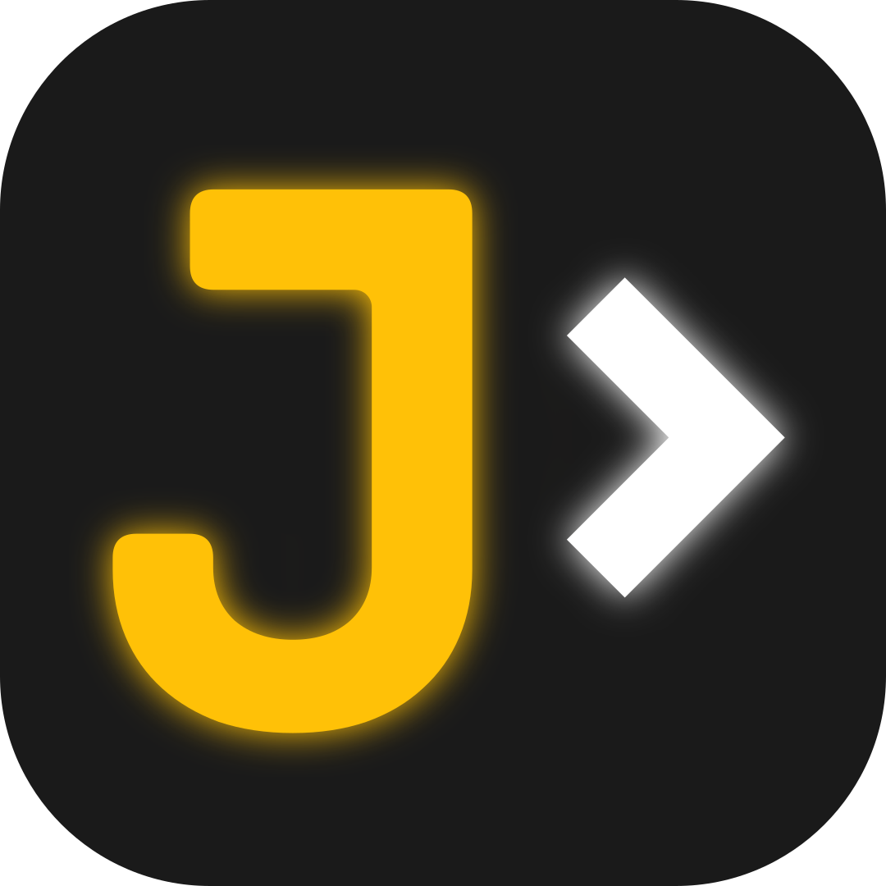

  

<h1 align="center">Jotta Edit</h1>

  <strong>A focused editor for code, Markdown and web projects.</strong>

  Linux &nbsp;·&nbsp; Windows &nbsp;·&nbsp; Web

  <a href="https://edit.jotta.pt/">Open the web app</a>

---

## The idea

Jotta Edit is a personal code editor created by **João Jotta**. Its goal is to bring together the things he likes most about **Sublime Text** and **VS Code**, in an editor shaped around his own everyday workflow.

## Code with familiar tools

| Feature | What you can do |
| :--- | :--- |
| **Tabs & split editing** | Work with multiple files in two resizable panes and compare a document with its saved version. |
| **Quick navigation** | Jump to files or lines, switch languages and find commands through the command palette. |
| **Project search & replace** | Search across files and unsaved drafts, preview replacements and choose which files to change. |
| **Code assistance** | Use syntax highlighting, automatic language detection, multiple cursors, Emmet expansion and optional language-server completion on desktop. |
| **Formatting** | Format code with Prettier, enable format on save and choose your indentation and line-width preferences. |
| **File Explorer** | Create, rename and organise files and folders with context actions, drag-and-drop moves and recoverable deletion. |

## Write, preview & export

- **Markdown workspace** — Write with a live, resizable preview and formatting tools for headings, emphasis, links, images, code, lists, checklists and tables.
- **HTML & PDF export** — Turn Markdown drafts into styled documents with local images included. Desktop saves PDFs directly; the web edition uses the browser print dialog.
- **Desktop live preview** — Preview HTML, CSS and JavaScript changes in your browser as you type, including unsaved edits. Preview saved PHP files with a local PHP runtime.

## Make it yours

- **Custom themes** — Choose syntax palettes inspired by familiar editors, create your own, and import or export theme files.
- **Independent interface colours** — Personalise light and dark modes, panel colours, accents and Explorer icon palettes.
- **Colour tools** — Edit colours with the built-in mixer and display colour values as inline swatches or coloured backgrounds.
- **Personal preferences** — Adjust editor and interface fonts, word wrap, minimap and project-specific editing settings. Use the interface in **English** or **Portuguese (Portugal)**.

## Keep your work close

- **Session recovery** — Restore your tabs, unsaved drafts and pending edits when you reopen the app.
- **Local history** — Browse saved versions, compare them with your current draft and restore changes with Undo support.
- **Recent workspaces & favourites** — Return to recent projects and save favourite local folders or remote servers.
- **Remote folders** — Edit directly over **FTP, SFTP or SMB** on desktop, with optional encrypted credential saving and checks for server-side changes before saving.

## Desktop or browser

**Linux** ships as a Flatpak. **Windows** ships as a portable executable: **no installation required**.

The **web edition** is an installable, offline-capable app with browser workspaces, folder and ZIP import/export, and direct local file or folder access where the browser supports it.
